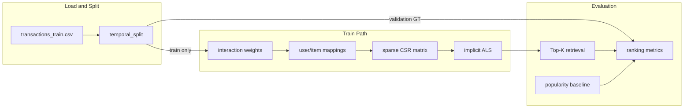

# ALS Retrieval Baseline for H&M

## Current State

The repo is **data-only**. Existing CSVs live at [`data/transactions_train.csv`](data/transactions_train.csv), [`data/customers.csv`](data/customers.csv), and [`data/articles.csv`](data/articles.csv) (~31.8M transactions, date range **2018-09-20 → 2020-09-22**). No Python code, configs, or git history exists yet.

**First action:** reorganize data to match the target layout by moving (or symlinking) the three CSVs into `data/raw/` and adding empty `data/processed/` and `data/mappings/` directories.

---

## Architecture



**Key principle:** ALS sees **only training interactions** (dates strictly before the validation window). Validation labels come from the final `validation_days` window (default: last 7 days ≈ 2020-09-16 → 2020-09-22).

---

## Files to Create

| Path | Purpose |
|------|---------|
| [`configs/als.yaml`](configs/als.yaml) | All hyperparameters and paths |
| [`requirements.txt`](requirements.txt) | `polars`, `pandas`, `numpy`, `scipy`, `implicit`, `pyyaml`, `pyarrow` |
| [`src/data/load.py`](src/data/load.py) | Polars lazy load of transactions (3 cols only) |
| [`src/data/temporal_split.py`](src/data/temporal_split.py) | Cutoff-based train/val split + logging |
| [`src/data/mappings.py`](src/data/mappings.py) | Train-only ID maps, parquet persistence |
| [`src/features/interactions.py`](src/features/interactions.py) | binary / count / recency weighting |
| [`src/retrieval/als.py`](src/retrieval/als.py) | ALS wrapper, train/save/load, recommend |
| [`src/retrieval/popularity.py`](src/retrieval/popularity.py) | Global Top-K popularity baseline |
| [`src/evaluation/ranking_metrics.py`](src/evaluation/ranking_metrics.py) | Recall, HitRate, MAP, NDCG @ configurable K |
| [`src/pipelines/train_als.py`](src/pipelines/train_als.py) | End-to-end train + artifact save |
| [`src/pipelines/evaluate_als.py`](src/pipelines/evaluate_als.py) | Full eval + comparison table |
| [`README.md`](README.md) | ALS role, limitations, run commands |

Minimal `src/__init__.py` files only if needed for imports; no heavy abstraction layers.

---

## Module Design

### 1. Load transactions — [`src/data/load.py`](src/data/load.py)

- Use **Polars** `scan_csv` with `columns=["t_dat", "customer_id", "article_id"]` to avoid loading price/channel into memory.
- Parse `t_dat` as `Date`; sort by date when needed downstream.
- Return a Polars `DataFrame`; log row count, unique users/items, min/max date.
- Function signature: `load_transactions(path: str) -> pl.DataFrame`

### 2. Temporal split — [`src/data/temporal_split.py`](src/data/temporal_split.py)

```python
def temporal_split(df, validation_days: int) -> tuple[pl.DataFrame, pl.DataFrame, date]:
    max_date = df["t_dat"].max()
    val_start = max_date - timedelta(days=validation_days - 1)
    train = df.filter(pl.col("t_dat") < val_start)
    val   = df.filter(pl.col("t_dat") >= val_start)
```

- **Train:** `t_dat < val_start` (strictly before validation window)
- **Validation:** `t_dat >= val_start` (inclusive last N days)
- Log all counts requested; compute cold-start stats:
  - `val_users_unseen_in_train`, `val_items_unseen_in_train`
- Return `val_start` as the recency reference date for weighting.
- Sanity assert: `train["t_dat"].max() < val["t_dat"].min()` (or `<= val_start - 1 day`).

### 3. Interaction weighting — [`src/features/interactions.py`](src/features/interactions.py)

Single entry point:

```python
def build_interactions(
    train_df: pl.DataFrame,
    method: Literal["binary", "count", "recency"],
    reference_date: date,
    recency_lambda: float = 0.01,
) -> pl.DataFrame  # columns: user_id, item_id, interaction_weight
```

| Method | Logic |
|--------|-------|
| `binary` | group_by `(customer_id, article_id)` → weight = 1 |
| `count` | group_by → weight = count |
| `recency` | per-row `exp(-λ * age_days)` where `age_days = (reference_date - t_dat).days`, then sum per pair |

- Rename columns to `user_id`, `item_id` for downstream clarity.
- Log 3–5 example repeated pairs with their aggregated weights.
- Assert all weights > 0, no NaNs.

### 4. Mappings — [`src/data/mappings.py`](src/data/mappings.py)

- Build **from training interactions only**:
  - `customer_id → user_idx` (0..N-1, sorted for determinism)
  - `article_id → item_idx` (same)
- Save to [`data/mappings/user_mapping.parquet`](data/mappings/user_mapping.parquet) and [`data/mappings/item_mapping.parquet`](data/mappings/item_mapping.parquet) with both forward and reverse columns.
- Functions:
  - `build_mappings(interactions_df) -> (user_map, item_map)`
  - `apply_user_map(df, user_map) -> df with user_idx` (rows with unknown users → dropped/flagged)
  - `apply_item_map(df, item_map) -> df with item_idx`
- Validation: explicitly tag rows with unknown users/items; never assign dummy index 0.

### 5. Sparse CSR matrix — in [`src/features/interactions.py`](src/features/interactions.py) or small helper

```python
def build_csr_matrix(
    interactions: pl.DataFrame,  # user_idx, item_idx, interaction_weight
    num_users: int,
    num_items: int,
) -> scipy.sparse.csr_matrix
```

- Shape: `[num_train_users, num_train_items]`
- Log shape, nnz, density, approximate memory (`nnz * (8+4+4)` bytes).
- Assertions: valid indices, weights > 0, no NaNs.
- **Never** densify.

### 6. ALS wrapper — [`src/retrieval/als.py`](src/retrieval/als.py)

Use `implicit.als.AlternatingLeastSquares`:

```python
# implicit expects user × item CSR matrix
# Confidence: C_ui = 1 + alpha * r_ui  (standard implicit-feedback formulation)
# Pass weighted interactions as r_ui; let wrapper apply alpha per config
model = AlternatingLeastSquares(factors=..., regularization=..., iterations=..., random_state=...)
model.fit(user_item_csr)  # shape (users, items)
```

**Important API notes (documented in code comments):**
- Matrix orientation: **users × items** CSR (row = user, col = item).
- `implicit` uses confidence `C = 1 + alpha * preference`; do not double-multiply alpha.
- `model.recommend(user_idx, user_items[user_idx], N=k, filter_already_liked_items=...)` for single user.
- Batch: loop over validation user indices using `model.recommend` (implicit supports this efficiently; avoid manual dot-product loops).
- Expose: `user_factors`, `item_factors`, `recommend()`, `recommend_batch()`.
- Save/load via `pickle` or `implicit`'s built-in serialization to [`artifacts/als/`](artifacts/als/) (model + config snapshot + matrix metadata).

### 7. Candidate retrieval — [`src/retrieval/als.py`](src/retrieval/als.py)

Return Polars/DataFrame:

| customer_id | article_id | als_score | rank |

- Map `user_idx → customer_id`, `item_idx → article_id` via reverse mappings.
- Configurable `candidate_k` (default 200), `filter_seen` (default true).
- Post-retrieval sanity: scores descending per user; no seen items when filtering enabled; all article IDs in item mapping.

### 8. Popularity baseline — [`src/retrieval/popularity.py`](src/retrieval/popularity.py)

- Rank training items by purchase count (or unique-user count — configurable, default purchase count).
- Same Top-K for every validation user; optional per-user seen filtering.
- Return same schema (with `pop_score` instead of `als_score`).

### 9. Ranking metrics — [`src/evaluation/ranking_metrics.py`](src/evaluation/ranking_metrics.py)

For each evaluable validation user:

- **Ground truth:** unique `article_id`s purchased in validation window.
- **Retrievable GT:** exclude items not in training item mapping.

Metrics per user, then macro-averaged:

| Metric | Definition |
|--------|------------|
| Recall@K | \|GT ∩ TopK\| / \|GT\| |
| HitRate@K | 1 if \|GT ∩ TopK\| > 0 else 0 |
| MAP@K | mean AP over relevant items in TopK |
| NDCG@K | standard DCG/IDCG |

Report **two recall variants** clearly named:
1. `recall_all_gt@K` — denominator = all validation GT items
2. `recall_retrievable@K` — denominator = GT items present in training item universe

Primary reporting Ks: **50, 100, 200** (recall) + **MAP@12, NDCG@12**.

Also report aggregate diagnostics:
- % validation users evaluable by ALS
- % validation interactions with unseen items
- candidate coverage (% of retrievable GT items appearing in any user's candidate pool)
- avg GT items per user

### 10. Pipelines

**[`src/pipelines/train_als.py`](src/pipelines/train_als.py)**
```
load → split → weight → map → CSR → train ALS → save artifacts
```
CLI: `python -m src.pipelines.train_als --config configs/als.yaml`

**[`src/pipelines/evaluate_als.py`](src/pipelines/evaluate_als.py)**
```
load → split → weight → map → CSR → train/load ALS → retrieve → metrics (ALS + popularity) → print table
```
CLI: `python -m src.pipelines.evaluate_als --config configs/als.yaml [--load-model]`

Both pipelines use `logging` module, fixed seeds, and run all sanity checks from Step 13.

### 11. Configuration — [`configs/als.yaml`](configs/als.yaml)

Exactly as specified, with path default:

```yaml
data:
  transactions_path: data/raw/transactions_train.csv
split:
  validation_days: 7
interaction_weighting:
  method: recency
  lambda: 0.01
als:
  factors: 128
  regularization: 0.05
  iterations: 20
  alpha: 20
  random_state: 42
retrieval:
  candidate_k: 200
  filter_seen: true
evaluation:
  ks: [12, 50, 100, 200]
```

Experiment support: change YAML + rerun. Optional `--config configs/als_factors256.yaml` copies for grid runs (no experiment framework).

### 12. Quality checks (embedded in pipelines)

- Train max date < validation min date
- No validation rows in CSR matrix
- Mappings built from train only; matrix shape == mapping sizes
- ALS factor dims match config
- Sample 3–5 users: print top-5 recs, verify descending scores
- Filter-seen verification
- Recommended article IDs ⊆ training item set

---

## README Section (concise)

Document:
- ALS dot-product scoring: `score(u,i) = user_factors[u] · item_factors[i]`
- ALS role: **candidate generator only** (Top-K → future ranker / Two-Tower)
- Limitations: user/item cold start, no metadata, opaque latent factors

---

## Commands (post-implementation)

```bash
# Install
pip install -r requirements.txt

# Train
python -m src.pipelines.train_als --config configs/als.yaml

# Evaluate (train + eval in one pass, or load saved model)
python -m src.pipelines.evaluate_als --config configs/als.yaml
```

**Expected outputs:**
- Logs: dataset stats, split stats, matrix stats, training time
- Artifacts: `artifacts/als/model.pkl`, factor matrices, config copy
- Mappings: `data/mappings/*.parquet`
- Eval table:

```
Model       Recall@50  Recall@100  Recall@200  MAP@12  NDCG@12
Popularity  ...
ALS         ...
```

Plus cold-start / coverage diagnostics.

**Runtime estimate:** Full 31M-row dataset — Polars aggregation + CSR build ~2–5 min; ALS training (128 factors, 20 iter) ~5–15 min depending on hardware. First run validates end-to-end; subsample flag can be added later if needed (not in scope unless requested).

---

## Assumptions

1. Data files will be placed under `data/raw/` (moved from current `data/` location).
2. `customers.csv` / `articles.csv` are **not** ALS inputs; used only if needed for debug prints.
3. Evaluation restricted to validation users present in training (cold-start users reported separately).
4. Validation window = last N **calendar days** inclusive of max date.
5. Recency weighting reference date = validation start date (last day of training).
6. `implicit` installed with OpenMP support (may require `brew install libomp` on macOS — noted in README).

---

## Next Experiment After Baseline

Run a small hyperparameter grid by copying `configs/als.yaml`:

| Run | Change |
|-----|--------|
| A | `factors: 64` vs `128` vs `256` |
| B | `regularization: 0.01` vs `0.05` vs `0.1` |
| C | `alpha: 10` vs `20` vs `40` |
| D | `interaction_weighting.method: binary` vs `count` vs `recency` |

Compare **Recall@100** and **MAP@12** across runs. Best config becomes the fixed candidate generator for the next milestone (ranking model).
